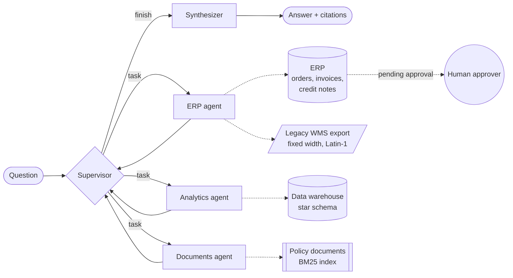

# Enterprise Agent Hub

A multi-agent system built with LangGraph that answers business questions across four kinds of enterprise data: an ERP (orders, invoices, credit notes), a sales data warehouse, a fixed-width export from a legacy warehouse system, and company policy documents.

A supervisor agent splits each question into tasks and routes them to three specialist agents. Each specialist runs its own tool-calling loop over the systems it is allowed to touch. A synthesizer then writes one answer from their findings, with source citations. The only action that changes data, a credit note, is created as a request and waits for a human to approve it.

```
Q: For Brennwerk GmbH: list overdue invoices, revenue in 2025, and our policy on late payment.

A: 2 overdue invoice(s), EUR 9,153.71 open in total: INV-5001 Brennwerk GmbH EUR 8,546.43 (14 days);
   INV-5017 Brennwerk GmbH EUR 607.28 (4 days). Revenue from Brennwerk GmbH: EUR 110,295.30.
   An invoice becomes overdue on the first day after its due date. After 14 days overdue, the account
   manager sends a first reminder. After 30 days overdue, finance sends a second reminder and may put
   new orders for that customer on hold. [payment_terms.md#late-payment]

run 3f1c… | agents: erp, analytics, docs | tool calls: 3 | tool errors: 0
```

## Architecture



| Agent | Tools | Data source |
|---|---|---|
| ERP | `get_order`, `get_invoice`, `list_overdue_invoices`, `get_stock_level`, `request_credit_note` | ERP adapter (SQLite simulator with the same contract as a REST ERP), stock loaded from the legacy export |
| Analytics | `revenue_by_region`, `top_products`, `quarterly_revenue`, `customer_revenue`, `run_readonly_sql` | Star schema: `fact_sales`, `dim_customer`, `dim_product`, `dim_date` |
| Documents | `search_documents` | Markdown policies split into sections, ranked with BM25 |

## What makes it production-minded

**Guards on the agent loop**
- Hop limit for the supervisor (`HUB_MAX_HOPS`) and a tool-call limit per specialist (`HUB_MAX_TOOL_CALLS`).
- Loop detection: sending the same task to the same agent twice stops the run, and the answer says it may be incomplete.
- Tool allow-lists: an agent asking for another agent's tool gets a structured error, not access.
- Pydantic argument validation (id formats, positive amounts) before any system is called.

**Errors the model can work with**
Every tool returns `{"ok": false, "error": ..., "hint": ...}` instead of raising. Asked about `SO-9999`, the agent reports that the order does not exist rather than inventing a status. Asked about a SKU whose legacy row was corrupt, it says the row was quarantined and why.

**Human approval for writes**
`request_credit_note` checks the policy rules: the amount cannot exceed the invoice, and anything above EUR 500 needs the head of finance. It then creates a pending request. Approval happens over the API (`POST /approvals/{id}/decision`), and the role is checked again there.

**Legacy integration**
The warehouse export is Latin-1, CRLF, fixed-width. Rows with a non-numeric quantity or a truncated record are quarantined with a reason, never guessed.

**Read-only analytics**
`run_readonly_sql` accepts one `SELECT` over the four warehouse tables. Write keywords, multiple statements and unknown tables are rejected, and the connection itself is opened read-only as a second line of defence.

**Observability**
- With `LANGFUSE_PUBLIC_KEY` and `LANGFUSE_SECRET_KEY` set, every run is sent to Langfuse as one trace: supervisor decisions, each agent, each model call and each tool call.
- Independently of Langfuse, a local trace is stored per run (`GET /runs/{id}`). It records routing decisions, tool arguments, errors, per-tool latency, guard stops and token usage. The eval harness reads its metrics from this trace.

## Evaluation

`eval/cases.jsonl` holds 36 labelled questions:

| Category | Cases |
|---|---|
| ERP | 10 |
| Analytics | 6 |
| Documents | 8 |
| Multi-agent, up to all three specialists in one question | 7 |
| Failure cases (unknown id, quarantined data, credit note above the invoice amount, a quarter that has not happened, a false premise in the question) | 5 |

Each case defines:
- the agents that should be used,
- facts the answer must contain,
- facts it must not contain,
- the number of approvals it should create.

Each eval run seeds fresh data in a temporary directory.

```bash
python eval/run_eval.py                                                     # offline
HUB_LLM_PROVIDER=openai HUB_LLM_MODEL=<model> python eval/run_eval.py       # hosted model
```

Results are written to `eval/results_<provider>.json`.

**Offline run**

| Metric | Result |
|---|---|
| Cases passed | 36/36 |
| Routing accuracy | 100% |
| Answer accuracy | 100% |
| p95 latency | under 10 ms |

The offline model (`ScriptedChatModel`) is a deterministic, rule-based LangChain chat model. It supports `bind_tools` and returns real tool calls. It was developed against this eval set, so the offline score shows that the graph, tools, guards and approval flow work end to end. It does not measure the quality of a language model.

The offline model also gave me a useful failure. One question asks for a credit note "and who must approve it according to policy". Splitting the question into clauses gave the documents agent "who must approve **it**", and retrieval returned the wrong policy section. The fix was to carry the clause a pronoun refers to into the sub-task, and to weight section headings in BM25.

The same harness runs against a hosted model. That is the number to look at for model quality and cost per question.

## Quickstart

```bash
python -m venv .venv && source .venv/bin/activate      # Windows: .venv\Scripts\activate
pip install -e ".[dev]"
python -m agent_hub.seed                                # builds var/erp.db, var/dwh.db, loads the legacy export
python -m agent_hub.cli "Which invoices are overdue for Lechtal Bau, and how much revenue did Lechtal Bau bring in 2025?"
python -m agent_hub.cli --trace "Create a credit note for INV-5001 of EUR 800 because of damaged goods"
pytest -q                                               # 37 tests
uvicorn agent_hub.api:app --reload                      # http://localhost:8000/docs
```

To run with a hosted model:

```bash
pip install -e ".[openai]"        # or ".[anthropic]"
export HUB_LLM_PROVIDER=openai HUB_LLM_MODEL=<model name> OPENAI_API_KEY=...
```

Docker:

```bash
docker build -t enterprise-agent-hub .
docker run -p 8000:8000 --env-file .env enterprise-agent-hub
```

## API

| Method | Path | Purpose |
|---|---|---|
| `POST` | `/ask` | `{"question": "..."}` returns the answer, the findings per agent, the approvals created and the run metrics |
| `GET` | `/runs/{run_id}` | Full trace of a run |
| `GET` | `/approvals` | Credit note requests waiting for a decision |
| `POST` | `/approvals/{id}/decision` | `{"approve": true, "approver_role": "head_of_finance"}` |
| `GET` | `/health` | Status, model provider, whether Langfuse is on |

## Project layout

```
src/agent_hub/
  graph.py        supervisor, specialists, synthesizer, guards, Hub entry point
  tools.py        LangChain tools with validated arguments and a common result envelope
  llm.py          model factory (OpenAI, Anthropic) and the offline ScriptedChatModel
  prompts.py      system prompts and the status block the supervisor reads
  tracing.py      per-run trace and run store
  api.py, cli.py  FastAPI service and command line
  systems/        erp.py, dwh.py, docs.py, legacy.py
data/             policy documents and the legacy warehouse export
eval/             labelled cases and the eval runner
tests/            37 tests: systems, guards with misbehaving models, API
```

## Next steps

- Swap BM25 for a vector store with hybrid search. The `DocumentStore.search` contract stays the same, so the agents do not change.
- Run the supervisor and specialists on different models: a cheap model for routing, a stronger one for synthesis. Compare cost and accuracy with the eval harness.
- Persist graph state with a LangGraph checkpointer, so an approval can resume a paused run instead of being a separate API call.
- Add online evaluation by scoring a sample of production traces in Langfuse.
